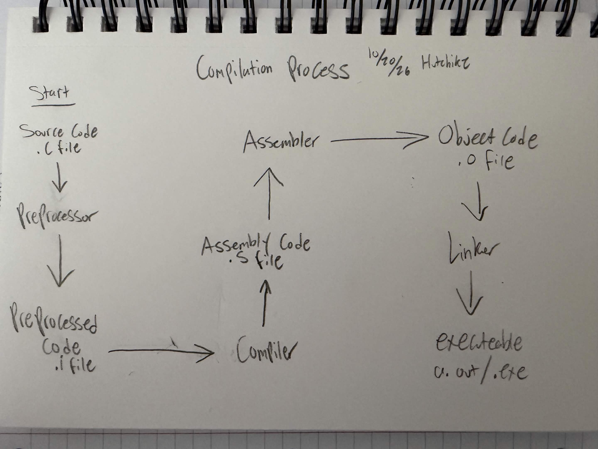

# Module 01: basics

**Course module:** [01-basics](https://github.com/Shuvam-Banerji-Seal/C-Programming-for-Beginners/tree/main/01-basics)

**Started:** 2026-10-20 · **Finished:** 2026-10-20

## Why is C important? 
- Foundation for most MODERN languages
- Good performance 
- C runs on everything
- Learning C helps you understand how computers work

## Compilation process



## Compilation explained
- Preprocessing: Does directives like #include
- Compilation: Converts C -> Assembly
- Assembly: Converts Assembly -> Machine code
- Linking: Connects obj files with libraries to make executables

## Breaking down Hello World
```c
#include <stdio.h>              // includes the standard I/O library

int main(){                     // the main() function of the program
    printf("Hello World");      // printf() - function that prints text

    return 0;                   // 0 = complete/successful
}
```

## Format Specifiers
| Format Specifier| Size (bytes) | Data Type |
| --------------- | ------------ | ----------|
| %d              | 4            | int       |
| %f              | 4            | float     |
| %lf             | 8            | double    |
| %c              | 1            | char      |
