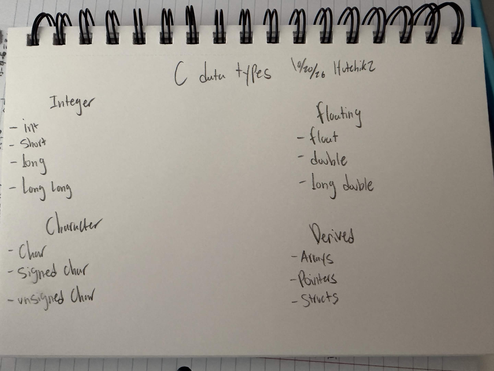
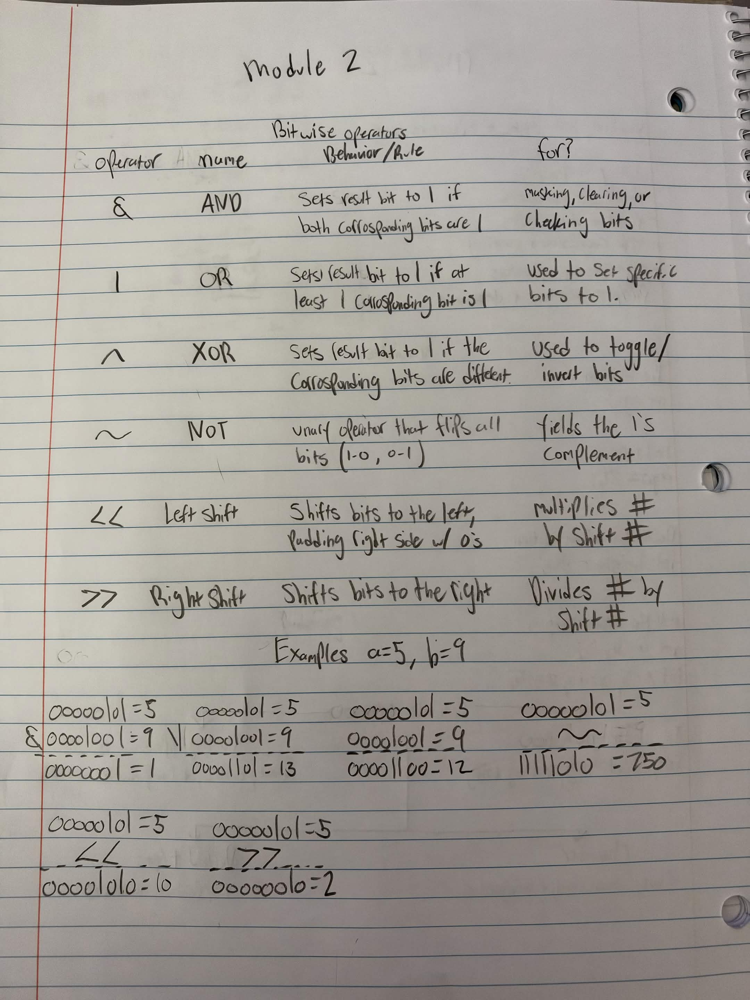

# Module 02: variables-and-types

**Course module:** [02-variables-and-types](https://github.com/Shuvam-Banerji-Seal/C-Programming-for-Beginners/tree/main/02-variables-and-types)

**Started:** 2026-10-20 · **Finished:** 2026-10-20

## Variables
Declaration
int age;

Initialization 
age = 20;

Declaration + Initialization 
int age = 20;

Multiple Declarations
int a, b, c;
int x=5, y=10, z=15;

## C Data Types

## Bitwise

